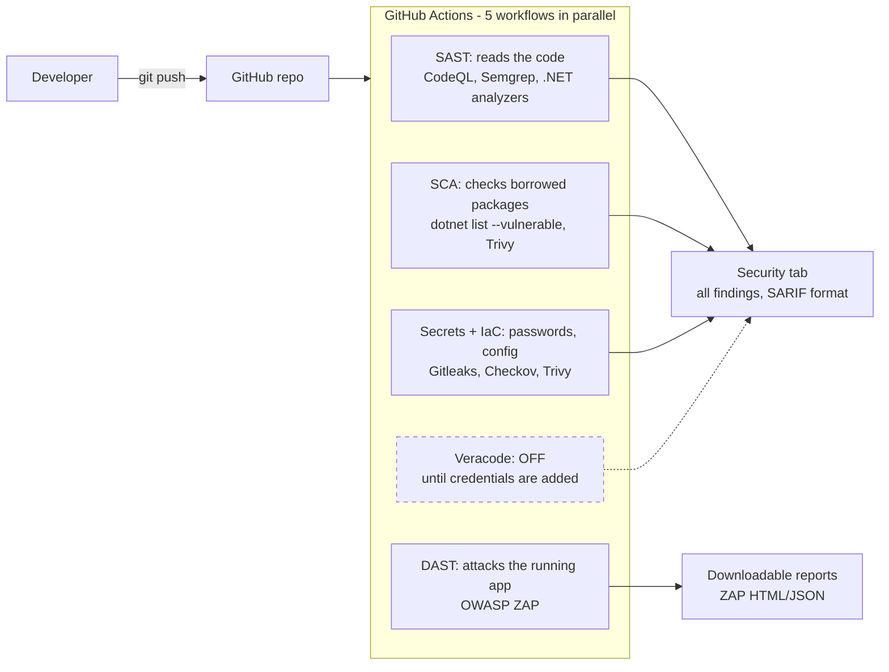
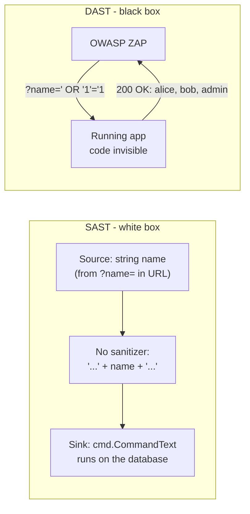

# SecDev-vercode — automated security scanning POC

Learning proof-of-concept: how to wire **Veracode** and open-source security scanners into a CI/CD
pipeline, using a small, deliberately vulnerable ASP.NET Core app as the target.

> **WARNING — intentionally vulnerable code.** `src/VulnApp` contains SQL injection, command injection,
> XSS, insecure deserialization and more, on purpose. Run it only on `127.0.0.1` or inside a CI runner.
> Never deploy it, expose it to a network, or copy its code into a real project.
> The "secrets" in the repo are random values, not real credentials.

## In one minute

| Question | Answer |
|---|---|
| **What did we build?** | A small web app with security holes planted on purpose, plus automated scanners in GitHub that hunt for those holes on every push. |
| **Who did the scanning, if not Veracode?** | Free tools run by GitHub Actions: CodeQL, Semgrep, .NET analyzers, `dotnet list --vulnerable`, Trivy, Gitleaks, Checkov, OWASP ZAP. |
| **Why no Veracode?** | Veracode is a paid product with no free tier. No credentials were available, so its pipeline is written but skips itself until switched on. |
| **What did we learn?** | Free tools catch leaked passwords, outdated packages and bad config well. Locally they missed 4 of 8 code flaws. That gap is what CodeQL and Veracode should be tested on. |

## How it works

GitHub Actions is GitHub's built-in automation. Each file in `.github/workflows/` is a recipe:
"when code changes, start a fresh machine and run these tools". There are five recipes. Four run free
tools. The fifth (Veracode) checks for the `VERACODE_ENABLED` switch, finds it missing, and skips itself.



Every tool writes results in **SARIF**, a shared format, so findings from different vendors appear in one
list under the repo's *Security → Code scanning* tab.

## The five kinds of scan, in plain words

Think of the app as a house being built. Each scan checks a different thing, at a different moment.
None of them alone is enough.

| Scan | Plain meaning | House analogy | Finds | Tools here | Example from this repo |
|---|---|---|---|---|---|
| **SAST** — Static Application Security Testing | Reads your source code without running it | Inspector reads the blueprints | SQL injection, XSS, weak crypto | CodeQL, Semgrep, .NET analyzers | `"WHERE name = '" + name + "'"` flagged as SQL injection |
| **SCA** — Software Composition Analysis | Checks third-party packages you borrow | Checking bricks against the supplier's recall list | Package versions with known CVEs | `dotnet list --vulnerable`, Trivy | Newtonsoft.Json 12.0.1 has CVE-2024-21907 |
| **Secrets** | Searches files and git history for credentials | Key left under the doormat | Passwords, API keys, tokens | Gitleaks | Fake key + DB password in `Secrets.cs` |
| **IaC** — Infrastructure as Code | Checks files that describe servers | Building permit: do the doors lock? | Public storage, open ports, running as admin | Checkov, Trivy | S3 bucket `public-read`, SSH open to the internet |
| **DAST** — Dynamic Application Security Testing | Attacks the app while it runs, like a real attacker | Friendly burglar tries every door | What is actually exploitable, missing security headers | OWASP ZAP | Sends `<script>` into the search box |

> **"DIST"?** There is no DIST scan; it is usually a mix-up with **DAST**. A related term is **IAST**
> (Interactive testing): an agent inside the running app watches while it is attacked. Not used here.

### Reading the code vs. attacking the app

SAST sees inside (white box). DAST only sees the outside (black box). The same SQL injection, both ways:



- **SAST** reports `CWE-89` with file and line number, in seconds to minutes, before the app runs.
- **DAST** reports "SQL Injection, High" with the URL and payload that worked; it needs a running app but proves the hole is real.

### Where each scan fits in a project's life

Fixing problems early is cheapest ("shift left"), so scans are spread across the journey:

| Scan | Write code | Commit | Pull request | Build | Test server | Production |
|---|:-:|:-:|:-:|:-:|:-:|:-:|
| Secrets | ● | ● | ● | | | |
| SAST | ● (IDE) | ● | ● | ● | | |
| SCA | | | ● | ● | ● | ● (weekly re-check) |
| IaC | | | ● | ● | | |
| DAST | | | | | ● | ● |

SCA repeats on a schedule because new CVEs are published against code you did not change.

## Every tool and framework involved

| Tool | Kind | Made by | Cost | Job in this POC |
|---|---|---|---|---|
| .NET 10 / ASP.NET Core | App framework | Microsoft | Free | Builds the vulnerable sample app |
| SQLite | Database | Open source | Free | Tiny file database so SQL injection is real |
| Docker | Containers | Docker Inc. | Free | Packages the app for ZAP; runs scanners locally |
| Terraform | Infrastructure code | HashiCorp | Free | Sample cloud setup with bad settings (never deployed) |
| GitHub Actions | CI/CD automation | GitHub | Free on public repos | Runs all scans on every push |
| CodeQL | SAST | GitHub | Free on public repos | Deep data-flow tracing, closest free match to Veracode |
| Semgrep | SAST | Semgrep Inc. | Free community rules | Fast pattern search, easy custom rules |
| .NET analyzers | SAST | Microsoft | Free | Warnings in every build and in the IDE |
| `dotnet list --vulnerable` | SCA | Microsoft | Free | NuGet packages with known CVEs |
| Trivy | SCA + IaC | Aqua Security | Free | Packages, container image, Dockerfile/Terraform |
| Gitleaks | Secrets | Open source | Free | Keys and passwords in git history |
| Checkov | IaC | Prisma Cloud | Free | ~1,000 policy rules for Docker and cloud config |
| OWASP ZAP | DAST | OWASP / Checkmarx | Free | Attacks the running app |
| **Veracode** | SAST + SCA + DAST | Veracode | **Paid** | Wired in, waiting for credentials |

Other tools in the same space: SonarQube, Snyk, Checkmarx, OpenText Fortify, GitLab Ultimate,
Burp Suite (DAST), GitHub Advanced Security (needed for code scanning on private repos).

## Results so far

Every flaw was planted on purpose, so the right answer is known. Local run, 19 Nov 2026
(CodeQL and ZAP results come from the GitHub Actions run; full detail in [docs/findings-matrix.md](docs/findings-matrix.md)).

| Planted flaw | CWE | .NET analyzers | Semgrep | Gitleaks | CodeQL | Veracode |
|---|---|:-:|:-:|:-:|:-:|:-:|
| SQL injection | 89 | ✅ | ✅ | — | pending | off |
| Cross-site scripting | 79 | ❌ | ❌ | — | pending | off |
| Command injection | 78 | ❌ | ❌ | — | pending | off |
| Path traversal | 22 | ❌ | ❌ | — | pending | off |
| Unsafe deserialization | 502 | ✅ | ❌ | — | pending | off |
| MD5 password hashing | 327 | ✅ | ❌ | — | pending | off |
| Server-side request forgery | 918 | ❌ | ❌ | — | pending | off |
| Open redirect | 601 | ❌ | ❌ | — | pending | off |
| Hard-coded secrets (2) | 798 | ❌ | ❌ | ✅ 2/2 | pending | off |

- **Packages and config: strong.** Both vulnerable packages found by `dotnet list` and Trivy. Checkov flagged 30 config problems, Trivy 20.
- **Code flaws: gaps.** 4 of 8 missed by every local tool. Semgrep cannot read Razor `.cshtml` pages, so it never saw the XSS. Spotting a dangerous pattern is not the same as following the data; the missed flaws need data-flow tracing.
- **Lesson:** no single tool is enough. If Veracode finds the four misses and CodeQL does not, that is a concrete reason to pay.

## Turning Veracode on

1. Request a Veracode trial (veracode.com); ask for Static Analysis and SCA.
2. In the Veracode Platform, create **API credentials** (ID + key), ideally for a dedicated service account.
3. In Veracode SCA, create an **agent token** for GitHub Actions.
4. In GitHub → *Settings → Secrets and variables → Actions*, add secrets `VERACODE_API_ID`,
   `VERACODE_API_KEY`, `SRCCLR_API_TOKEN`, and the variable `VERACODE_ENABLED` = `true`.
5. Push any change. The Veracode workflow now runs instead of skipping.

What becomes possible:

- **Pipeline Scan** — fast check on every pull request; can block a merge.
- **Policy Scan** — full scan of `main`, tracked over time against company rules (e.g. "no High flaws older than 30 days").
- **Scans the compiled app**, so Razor pages and code without source are covered.
- **Data-flow tracing** aimed at the flaws the free tools missed.
- **Baselines** — accept existing flaws, fail only on new ones.
- **Approval trail** — "false positive" claims need a security reviewer's sign-off.
- **Smarter SCA** — checks whether your code actually calls the vulnerable part of a package, plus licence risk.
- **Veracode Fix** — suggested code patches.

Full walkthrough: [docs/05-veracode-guide.md](docs/05-veracode-guide.md).

## Glossary

| Term | Meaning |
|---|---|
| **CWE** | A type of weakness in your code. CWE-89 = SQL injection. |
| **CVE** | One specific known bug in a published package version, e.g. CVE-2024-21907. |
| **SARIF** | Shared file format for scan results, so GitHub can show any tool's findings. |
| **False positive** | The tool raised an alarm but there is no real problem. |
| **False negative** | A real problem the tool missed (the four misses above). |
| **Gate** | A rule that fails the build, e.g. "stop if any new High finding". |
| **Baseline** | Snapshot of accepted old findings, so only new ones fail the gate. |
| **Shift left** | Running checks earlier, where fixes are cheaper. |
| **Source → sink** | Where untrusted input enters, and the dangerous place it ends up. |

## What is in this repo

| Path | Purpose |
|---|---|
| `src/VulnApp/` | .NET 10 minimal API + Razor page with 10 planted flaws, each tagged `POC-VULN: CWE-xxx` |
| `Dockerfile`, `infra/terraform/` | Intentionally misconfigured infrastructure for IaC scanners (Terraform is never applied) |
| `.github/workflows/sast.yml` | CodeQL, Semgrep, Roslyn analyzers |
| `.github/workflows/sca.yml` | `dotnet list package --vulnerable`, Trivy (repo + container image) |
| `.github/workflows/secrets-iac.yml` | Gitleaks, Checkov, Trivy config |
| `.github/workflows/dast.yml` | OWASP ZAP baseline + active API scan against the running container |
| `.github/workflows/veracode.yml` | Veracode Pipeline Scan, Policy Scan, SCA — **off** until `VERACODE_ENABLED=true` |
| `scripts/run-local-scans.ps1` | Run the same scanners locally with Docker |
| `docs/` | Learning guides, Veracode onboarding, findings matrix |

## Quick start

```powershell
# run the app (http://127.0.0.1:5099)
dotnet run --project src/VulnApp --urls http://127.0.0.1:5099

# run scanners locally (needs Docker Desktop running)
./scripts/run-local-scans.ps1                # SAST, SCA, secrets, IaC
./scripts/run-local-scans.ps1 -IncludeDast   # + ZAP against the container
```

Results land in `scan-results/` (git-ignored). Open `.sarif` files with the VS Code *SARIF Viewer* extension.

In GitHub: see *Actions* for runs and *Security → Code scanning* for SARIF results.

## Learning path

1. [Overview](docs/00-overview.md) — SAST vs SCA vs DAST vs secrets/IaC
2. [SAST](docs/01-sast.md) · [SCA](docs/02-sca.md) · [Secrets + IaC](docs/03-secrets-iac.md) · [DAST](docs/04-dast.md)
3. [Veracode guide](docs/05-veracode-guide.md)
4. [Findings matrix](docs/findings-matrix.md) — which tool caught which planted flaw
